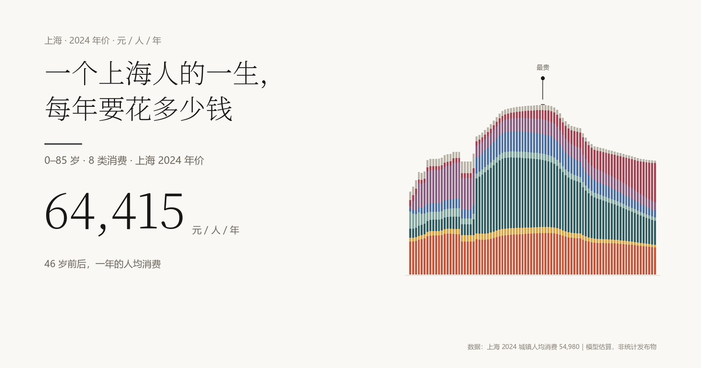

# 一个上海人的一生，每年要花多少钱

86 根柱子，一年一根：0 岁最省 31,540 元，四十几岁最贵 64,415 元。
**[看交互图 →](https://dao1023.github.io/life-in-86-bars/)**



> 中国没有任何公开的「按年龄分组八大类消费支出」表。这是模型估算，不是统计发布物。

## 一个上海人的一生：0–85 岁消费结构

> **一句话**：一张「一个在上海出生、上学、工作、结婚、老去的人，每年花多少钱、花在哪」的堆叠柱状图——0–85 岁、8 大类、元/人/年（2024 上海价），外加一个按户主年龄的「家庭口径」版本（元/户/年）。
> **能不能信**：**有条件可信**。总量与八大类锚点是官方数；年龄形状是「官方水平 × 文献形状」的估算，不是统计发布物。可引用量级与方向，不可引用任何单年数字或峰位。
> **文件在哪**：图在 `viz/lifecycle.html`；数据在 `data/shanghai_lifecycle.json`；模型在 `notes/model-spec.md`；审计链在 `notes/independent/`。

## 一、这是什么

图有 86 根柱（0–85 岁，85 岁档含 86–100），按食品、衣着、居住、生活用品、交通通信、教育文化娱乐、医疗保健、其他八类堆叠。曲线单峰：0 岁最低，学龄段抬升，成年平台，四十几岁见顶（模型值 46 岁），60 岁后缓降，85 岁医疗抬头。

三段含义：0–17 岁**家庭代付**（父母为孩子直接花的钱）；18–22 岁**大学成本**（学费、住宿、生活费）；23–85 岁**本人消费**（不是「户均 ÷ 人数」）。段间台阶是制度事实（谁掏钱），非消费骤降。家庭口径横轴换成户主 22–85 岁，按固定规则加总配偶与子女，得 64 根柱。

## 二、核心数字（v4，当前基准）

| 指标 | 人均（元/人/年） | 家庭（元/户/年） |
|---|---:|---:|
| 人口加权均值 | 54,979.9987（锚定 54,980） | 125,689.84（对锚 127,553.6 偏 −1.46%） |
| 峰值 | 46 岁 64,414.5 | 46 岁 175,436.6 |
| 谷值 | 0 岁 31,540.3 | 22 岁 46,000.0 |
| 峰谷比 | 2.04 | 3.81 |

关键梯度：退休前后 59→64 岁五年 **−12.4%**（其中 59→60 单年只掉 3.5%）；2→3 岁 **+8.6%**；5→6 岁 **+11.1%**；22→23 岁 **+14.0%**（毕业租房口径桥）；85 岁医疗 **14,881.5**，即官方口径医疗 10,881.5 + 居家照护 4,000。

## 三、数据从哪来

- **A 级官方**：上海 2024 年城镇居民（住户调查口径）人均消费 54,980 与八大类金额（国家统计年鉴 2025 表 6-27 上海行，与上海统计年鉴 2025 表 9.14「城镇常住居民」逐项互校；同口径全体居民为 52,722 元，表 6-21，本图选城镇口径以匹配城市叙事）；上海 2025 年 1% 人口抽样的四段结构（0–14 9.34% / 15–59 63.08% / 60+ 27.58% / 65+ 20.81%），单岁形状由 2020 七普推移；七普户均 2.317。
- **B 级文献**：倪红福等（2014）CHIPS 2007 城镇 25–69 岁「户主年龄 × 八大类占比」表（《人口与发展》20(5):25-34，表 2）；石贝贝（2017）CHARLS 60+ 八类占比；育娲《生育成本报告》分龄育儿成本；台湾 2024 家庭收支调查（经济户长年龄组）；美国 BLS CE 2023 微观 16–82 岁。
- **C 级构造**：年龄梯度方向（美/日/台形状 + 中国文献）、0–2 托育假设、18–22 大学段、23 岁口径桥、60–64 退休 glide。

**关键事实**：中国没有任何公开的「按年龄分组八大类消费支出」表（国家级、北上广深均无）。这张图是「官方水平 × 文献形状」的估算模型，不是统计发布物。

## 四、审计链

最值得看的是自我审计。A 先**盲测**：未看数据，先写 12 阶段 × 八大类先验。B 对照数据，提 5 条 P0：0–2 结构是假的、30–49 被家庭分母摊薄、18 岁 −25% 全是口径切换、「4 岁最贵」是 12,000 元幼儿园假设的产物、60 岁没有退休崖。重建 v2，峰从 4 岁移到 46 岁。C 判「有条件可信」，抓到 22→23 **+27.5%** 新断崖，0–2 医疗从 22.9% 压到 4.0% 的矫枉过正。v3 修 23 岁桥、硬台阶改五年 glide、重配 0–2 篮子。D 又抓到 2→3 **+24.9%** 成全表最大跳变，脚本只查降幅不查涨幅，属回归无人报。v4 补托育、脚本改双向、glide 给三档。E 判「部分修好」：2→3 高度全由「2 岁入托率 11%」一个参数决定，glide 归一后是全表平移。

**最终判决：有条件可信。**

## 五、能主张 / 不能主张

- 能：「上海家庭一生支出的量级与形状——0–17 年从 3.1 万升到 4.7 万，成年平台 5.5–6.4 万，23 岁租房、退休后医疗抬头是真实台阶。」
- 不能：「46 岁最贵（那是参数产物）、任何单年数字、85 岁医疗的精确值。」

## 六、已知局限

1. 没有上海分年龄微观观测，形状是借来的；美/日/台只定方向，中国文献只覆盖 25–69 或 60+。
2. 0–2 托育是假设（入托率 0.5%/5%/11%，月费 4,000 元），它决定 2→3 台阶高度与谷位；若三年都用 5%，2→3 变 +18.1%、谷回 2 岁。
3. 22→23 与 18 岁是口径桥，不是真实断崖：前者是校园住宿→上海合租，后者是家庭代付→大学成本。
4. 退休 −12.4% 里约 9.7pp 来自 glide 参数（去掉 ρ 只剩约 −2.7%），不是数据。
5. 户均锚 −1.46% 因家庭构成规则（一人户 11.1% vs 七普 28.4%）未重标定；家庭口径的水平与形状都别引用。
6. 台湾住房/教育形状被弃用：住房自有率 83.95%、设算租金使 U 形变浅；教育仅 2.4%，幅度差 2–3 倍。

## 七、文件地图

| 路径 | 内容 |
|---|---|
| `data/` | 内容：人均与家庭两套 CSV/JSON（86 行、64 行）、`shanghai_lifecycle_scenarios.csv`（低/基准/高）、`sensitivity_*`（幼儿园、A5 规模、长护、glide、托育）、`rebuild_diff*`（逐版 diff）、人口权重、国际对照、`archive/`（v1–v3 冻结）。 |
| `notes/` | `model-spec.md`（模型全文）、`model-spec-household.md`、`pop-source.md`（人口来源校验）、`AUDIT.md`（v1 审计）、`REBUILD-LOG.md`（v1→v4 日志）、`INTEGRATION.md`（权重收口）、`independent/`（A 盲测、B 对照、C 复核、D 收口、E 复检）。 |
| `research/` | A1 国际官方微观数据、A2 中国数据可得性、A3 理论先例、A4 中国分龄硬数字、A5 BLS 微观处理、A6 东亚对照。 |
| `viz/` | `lifecycle.html`（单文件交付物）、`build.py`（注入数据）、`template.html`（页面源）、三张截图（人均 1440/1920、家庭 1440）、`archive/` 与 `_tmp/`。 |
| `tools/` | 抓取与解析脚本；另有 `index.template.html`（落地页源）+ `build_index.py`（注入数字与数据，重出根目录 `index.html`）。 |
| 根目录 | `index.html`（落地页，发布入口）、`.nojekyll`、`build_lifecycle.py`（人均）、`build_household.py`（家庭）、`check_rebuild.py`（31 项验收）、三张落地页截图。 |

## 八、怎么看图

直接用浏览器打开 `viz/lifecycle.html`：单文件、零依赖、可离线、约 235 KB。别在聊天预览的窄卡片里看，宽度受限（设计宽 1440，1024 以下变窄，390 横向滚动）。可悬停看八类、点击钉住、图例 solo、金额/占比与人均/每户切换，另有幼儿园、老年折减、长护三开关。

## 九、版本链

v1（育娲总额 × 上海倍数、四等分，4 岁峰）→ v2（按 A/B 审计重建：分项篮子、46 岁峰）→ v3（修 22–23 桥、五年 glide）→ v4（补 0–2 托育、谷移到 0 岁、验收双向）。前三代存 `data/archive/`。

## 十、如何复现

按顺序执行：

```bat
python build_lifecycle.py     :: 人均：八类、三情景、五份敏感性
python build_household.py     :: 家庭口径 22–85（读上一步的 CSV）
python check_rebuild.py       :: 31 项验收：幂等、锚点、跳变 Top3
cd viz && python build.py     :: 注入两份 JSON，重出 lifecycle.html
cd viz && python build_og.py  :: 重出分享卡与图标（og-image / favicon）
cd .. && python tools/build_index.py   :: 注入数字，重出根目录 index.html
```

## 十一、落地页（index.html）

发布入口是根目录的 `index.html`（单文件、零依赖、约 82 KB），它不是图表页的副本，而是「一屏断言 + 六段滚动叙事 + 收尾三块」：

- **首屏**：眉题、88px 标题、一句断言「最贵的那一段，不在养孩子」，两个巨型数字对撞（64,415 / 31,540），底部一条细下滚线。1440×900 不滚动即可看完。
- **六段叙事**（`data-step="0..5"`）：左文右图，图占 62%（1440 下实测 809px），正文列 380px 封顶、列间距 72px；图上有多出一行身份标识「元／人／年 · 上海 2024 年价 · 模型估算」，y 轴只留 0/2/4/6 万三档网格。
- **高亮的做法（第三版，最终）**：图内**不加任何遮罩、矩形、引线**——焦点只靠淡化（带外 0.32，带内 0.92）。标注移到 **x 轴下方**：一条 1px 括号（水平细线 + 两端各 5px 上翘），跨度是「这一段」的年龄区间（如 14–22），标签在括号下方 6px、居中，如「17→18 岁 · 换人付 · −7.8%」。图内留白与网格都不再被压住。
  - 之前两版为什么废弃：整幅高的区间带会从矮柱里「探出头」像一根灰烟囱；带顶括线 + 竖引线会横穿绘图区、和 6 万网格线连成一条，读起来像「那条线被加粗了」。
  - 网格线降到 `#EDE8E0`（比原来淡一档），0 基线保留 `#C9C1B2`（它是轴，不是网格）。
  - 括号与 x 轴刻度不重叠：刻度基线在 +19，括号在 +40，实测刻度底 624 / 括号 636。
  - 单段两个标记时（第 6 段的 59–64 与 83–85）标签自动错开一行。
- **触发**：`IntersectionObserver` 只当触发器，回调改调 `pick()`（几何判定，取压在中线上的那一段），避免多段同时交叉时乱序；另有 `scroll` 位置计算与 350ms 轮询兜底——后台标签页里 IO 回调可能一次都不来。`Esc` 清空高亮，之后任何滚动/触摸/按键意图都会把它接回来（不能只依赖 `scroll` 事件：某些宿主不发）。
- **≤1100px**：图改为静态（不 sticky），随文字一起滚走——sticky 在这个宽度会把标题压在面板底下，而 820 宽的图缩到 350px 时图内文字只剩 4–5px。窄屏只给总览图，不做逐段标注。
- **收尾**：能说 / 不能说（与第五节一致）、五轮审计各一句 + 审计链链接、三个入口（完整图表 / 数据 / 源码）、页脚。
- **改文案**：只改 `tools/index.template.html`，数字用 `__PEAK__` 之类的占位符；不要手改 `index.html`，下次构建会被覆盖。

`python tools/build_index.py` 会读 `data/shanghai_lifecycle.json`，现算峰/谷/比/0–17 均值/18 岁台阶/23 岁居住/59→60 与 59→64/85 岁医疗/0 岁医疗与占比/0–17 两端/居家照护，并把整份 JSON 内联进页面。正文里的数字除段号 01–06 外全部来自占位符（`__T017__`、`__H0SH__`、`__W17__`、`__LTC__` 等），没有手写死的金额。

`build_lifecycle.py` 默认用 2025 实测人口权重；`--constructed-pop` 回退构造权重，`--diag` 只打印诊断，`--no-sensitivity` 跳过敏感性文件。无随机数，重跑逐字节一致。

## 十二、许可

- **代码**（`build_lifecycle.py`、`build_household.py`、`check_rebuild.py` 及 `tools/`、`viz/` 内的构建脚本）：MIT，见 [LICENSE](LICENSE)。
- **数据与文字**（`data/`、`research/`、`notes/`、`viz/og-image.*` 及本页文字）：CC BY 4.0，见 [LICENSE-DATA](LICENSE-DATA)。转载、改编请署名「Dao1023《一个上海人的一生，每年要花多少钱》」并链回本仓库。
- **问题、纠错、补充数据**：请开 [GitHub Issue](https://github.com/Dao1023/life-in-86-bars/issues)。

原始统计数字引自国家统计局、上海统计局、BLS 等公开出版物，其版权归各自发布机构。
