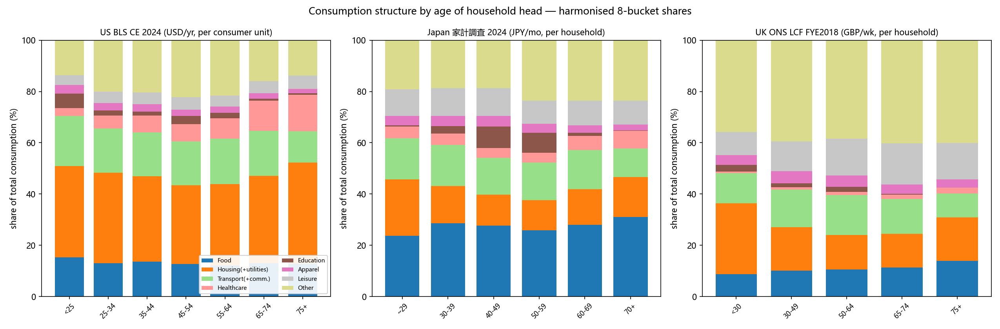

# A1 · 国际官方微观/分组数据：一个城市人一生的消费结构

> 抓取时间：2026-11-07（Asia/Shanghai）。所有数字均为**从官方原始文件解析出来的原表数字**，未做任何估算、补插或平滑。
> 每个数字的来源 URL、表号、年份均落在 `data/intl_age_consumption.csv` 的 `source_table` / `source_url` 列里，可逐行追溯。
> 凡未拿到的，正文与 CSV 里都写「未获取」，不使用任何替代数据冒充。

---

## 0. 结论先行

| 问题 | 结论 |
|---|---|
| 能否拿到「年龄 × 消费类别」的官方分组数据？ | **能，3 个国家**：美国 BLS CE（2023/2024/2025，7 个年龄组 × 8 类）、日本 家計調査（2024，7 个年龄组 × 10 类）、英国 ONS LCF（**仅 FYE2018**，5 个年龄组 × 12 类） |
| 哪一国最适合做「城市人一生」的**骨架**？ | **美国 BLS CE 2024**。理由见 §9：年龄组最细（含 65-74 / 75+ 拆分，正好覆盖退休到终老）、类别与生命阶段事件（教育、育儿、医保、养老金）一一对应、有户均人口可换人均、口径逐年可比、且是**consumer unit**（近似"家庭"）而非仅"户主" |
| 日本能不能当骨架？ | 可以当**东亚对照**，不宜当唯一骨架：只有「二人以上世帯」，**单身户（20-29 岁城市青年最典型的状态）被系统性排除**；且 2024 只有一年 |
| 英国能用吗？ | 只能当**远距离对照**：ONS 自 FYE2019 起**停止发布**按户主年龄分组的 A9/A10/A11 表，最新公开版停在 FYE2018（2017-18），年龄组也只有 5 档 |
| Eurostat / 韩国 | **未获取**，原因见 §6（不是没找，是公开表确实没有 age 维度 / 发布物里确实没有 age 分组表） |

---

## 1. 覆盖度总表

| 国家 | 来源 | 表号 | 年份 | 年龄组 | 类别数 | 原始单位 | 状态 |
|---|---|---|---|---|---|---|---|
| 美国 | BLS Consumer Expenditure Survey | Table 1300（Age of reference person） | **2023 / 2024 / 2025** | All, <25, 25-34, 35-44, 45-54, 55-64, 65+, 65-74, 75+ | 8 大类 + 残差 | USD / consumer unit / 年 | ✅ 完整 |
| 日本 | 総務省 家計調査 年報 家計収支編 | 第3表「世帯人員・世帯主の年齢階級別」 | **2024**（令和6） | 平均, ~29, 30-39, 40-49, 50-59, 60-69, 70+, 65+（再掲） | 10 大分類 | JPY / 世帯 / 月 | ✅ 完整（限二人以上世帯） |
| 英国 | ONS Living Costs and Food Survey | Table A9 / A10 | **FYE2018**（2017-18） | All, <30, 30-49, 50-64, 65-74, 75+ | 12 COICOP 组 + other | GBP / household / 周 | ⚠️ 仅 FYE2018 |
| 欧盟 | Eurostat HBS | hbs_str_t211 等 | — | **无 age 维度** | — | — | ❌ 未获取 |
| 韩国 | 统计厅 家計動向調査 | 年度报告 | 2024 | **无 age×类别 表** | — | — | ❌ 未获取 |

产出文件：

- `data/intl_age_consumption.csv` — 442 行，长表，**原始单位**（`mean_value`）+ 官方或计算 share（`share_pct`）
- `data/intl_age_consumption_share.csv` — 328 行，统一 8 桶口径的 share 长表（画图直接用这个）
- `data/intl_household_size.csv` — 41 行，户均人口（换人均的关键混杂变量）
- `viz/harmonised_shares_by_age.png` — 三国对照堆叠柱（图已生成，见 §7）
- `raw/` — 全部原始 .xlsx / .xls / .pdf，可离线复核
- 复现脚本：`build_dataset.py`（一条命令从 `raw/` 重建全部 CSV）、`fetch.py`（带浏览器头的抓取器）

### CSV 数据字典

| 列 | 含义 |
|---|---|
| `country` | US / JP / UK |
| `year` | 日历年（US 2023/2024/2025；JP 2024；UK 用 `FYE2018` = 2017-04~2018-03 财政年） |
| `age_band` | 户主（reference person / 世帯主 / HRP）年龄组，保留**原表写法**，不重编码 |
| `category` | 原表类别名（US 英文、JP 日文、UK 英文），不翻译、不合并 |
| `category_harmonized` | 统一 8 桶：food / housing / transport / healthcare / education / apparel / leisure / other（映射规则见 §7） |
| `mean_value` | 原表均值，单位见 `unit`；`..`（不可得）留空 |
| `share_pct` | 占该年龄组总消费的百分比。US 用 BLS 原表 Share 列；JP/UK 用 同表 类别/总消费 计算 |
| `unit` | 原始单位（三国的单位**不同**，见 §8） |
| `hh_size_people` | 该年龄组的户均人口（换人均用） |
| `source_table` / `source_url` | 表名与**可下载的原始文件 URL** |
| `note` | 缺失/口径说明 |

---

## 2. 美国 BLS Consumer Expenditure Survey 2024

**来源**
- 文件：`https://www.bls.gov/cex/tables/calendar-year/mean-item-share-average-standard-error/reference-person-age-ranges-2024.xlsx`
  （同规则可得 2023、2025；三份均已落盘为 `raw/bls_age_{2023,2024,2025}.xlsx`）
- 表名（表内 A1 单元格原文）：*"Table 1300. Age of reference person: Annual expenditure means, shares, standard errors, and relative standard errors, Consumer Expenditure Surveys, 2024"*
- 单一 sheet `Table 1300`；表头在第 3 行；每个条目下有 `Mean` / `Share` / `SE` / `RSE` 四行 —— 所以**share 是官方发布的，不是我们算的**。

**口径**：consumer unit（消费单元，≈ 共同承担主要开支的一群人，可含非亲属），**年支出、美元**。样本（加权）2024 年 135,760 千个消费单元。

**2024 年各组总消费（USD/年/消费单元）**

| All | <25 | 25-34 | 35-44 | 45-54 | 55-64 | 65+ | 65-74 | 75+ |
|---|---|---|---|---|---|---|---|---|
| 78,535 | 47,283 | 74,475 | 91,229 | 100,327 | 84,946 | 61,432 | 65,354 | 55,834 |

**2024 年八大类 share（%）与金额（USD/年）**

| 类别 | All | <25 | 25-34 | 35-44 | 45-54 | 55-64 | 65-74 | 75+ |
|---|---|---|---|---|---|---|---|---|
| Food（含外食，不含酒） | 12.9 / 10,169 | 15.3 / 7,215 | 12.9 / 9,630 | 13.7 / 12,460 | 12.7 / 12,772 | 12.0 / 10,214 | 13.0 / 8,483 | 12.8 / 7,168 |
| Housing（含水电燃料、自有房折算租金） | 33.4 / 26,266 | 35.6 / 16,853 | 35.4 / 26,380 | 33.3 / 30,369 | 30.6 / 30,747 | 31.8 / 27,019 | 34.2 / 22,329 | 39.4 / 21,999 |
| Transportation | 17.0 / 13,318 | 19.5 / 9,243 | 17.2 / 12,802 | 17.1 / 15,581 | 17.1 / 17,184 | 17.8 / 15,085 | 17.5 / 11,414 | 12.3 / 6,855 |
| Healthcare | 7.9 / 6,197 | 3.1 / 1,485 | 5.1 / 3,825 | 6.5 / 5,949 | 6.7 / 6,748 | 7.9 / 6,711 | 11.8 / 7,715 | 14.2 / 7,918 |
| Apparel & services | 2.5 / 2,001 | 3.3 / 1,541 | 3.0 / 2,220 | 2.9 / 2,649 | 2.5 / 2,547 | 2.4 / 2,032 | 2.1 / 1,377 | 1.7 / 942 |
| Entertainment | 4.6 / 3,609 | 3.9 / 1,835 | 4.3 / 3,224 | 4.5 / 4,128 | 4.8 / 4,803 | 4.4 / 3,706 | 4.8 / 3,122 | 5.2 / 2,888 |
| Education | 2.0 / 1,569 | **5.6 / 2,652** | 1.9 / 1,418 | 1.6 / 1,445 | **3.2 / 3,181** | 2.2 / 1,856 | 0.7 / 482 | 0.6 / 354 |
| Personal insurance & pensions | 12.5 / 9,797 | 9.4 / 4,428 | 14.4 / 10,701 | 14.8 / 13,465 | 14.9 / 14,948 | 14.3 / 12,172 | 7.0 / 4,579 | 3.4 / 1,908 |
| Other（残差：现金赠与、杂项等） | 7.1 / 5,609 | 4.3 / 2,031 | 5.7 / 4,275 | 5.7 / 5,183 | 7.4 / 7,397 | 7.2 / 6,151 | 9.0 / 5,853 | 10.4 / 5,802 |

（`Other = 总消费 − 上列 8 类`，由我们计算，用于让堆叠到 100%；BLS 原表另有 cash contributions / miscellaneous 两个独立条目，已并入 Other。）

**要点（都是数字自己说的）**
- 教育支出是双峰的：`<25` 5.6%（自己在读）+ `45-54` 3.2%（子女在读），65 岁后跌到 0.6-0.7%。
- 医保占比从 `<25` 的 3.1% 单调升到 `75+` 的 14.2%，**金额几乎不随年龄下降**（1,485 → 7,918），是老年唯一的"逆势"大类。
- 住房占比在 45-54 触底（30.6%）后回升到 75+ 的 39.4% —— 家庭变小但住房成本不降（自住折算租金仍在）。
- 养老金/保险 45-54 见顶（14.9%），75+ 只剩 3.4%。

**户均人口（`Average number in consumer unit` → `People`）**

| All | <25 | 25-34 | 35-44 | 45-54 | 55-64 | 65+ | 65-74 | 75+ |
|---|---|---|---|---|---|---|---|---|
| 2.4 | 1.9 | 2.6 | **3.3** | 3.0 | 2.2 | 1.8 | 1.9 | **1.6** |

同年 18 岁以下子女数：All 0.6 / <25 0.3 / 25-34 0.8 / 35-44 **1.4** / 45-54 0.8 / 55-64 0.2 / 65+ 0.1。

---

## 3. 日本 総務省 家計調査 2024（令和6）年報

**来源**
- e-Stat 数据集页：`https://www.e-stat.go.jp/stat-search/files?page=1&toukei=00200561&tstat=000000330001&layout=dataset&cycle=7&year=20240&month=0`
- 表：家計収支編 二人以上の世帯 **第3表**「世帯人員・世帯主の年齢階級別 1世帯当たり1か月間の収入と支出」
- 下载（statInfId `000040297516`）：`https://www.e-stat.go.jp/stat-search/file-download?statInfId=000040297516&fileKind=4` → `raw/jp_age_4.xlsx`（实为 OLE2 格式的 .xls，须用 xlrd 读）

**口径**：**二人以上世帯**（单人户不在内）、**月支出、日元**、全国。

**2024 年各组消费支出（JPY/月/世帯）**

| 平均 | ~29 | 30-39 | 40-49 | 50-59 | 60-69 | 70+ |
|---|---|---|---|---|---|---|
| 300,243 | 274,857 | 281,211 | 331,134 | 356,946 | 311,392 | 252,781 |

**十大分类 share（%）**

| 类别 | 平均 | ~29 | 30-39 | 40-49 | 50-59 | 60-69 | 70+ |
|---|---|---|---|---|---|---|---|
| 食料 | 28.3 | 23.7 | 28.6 | 27.7 | 25.8 | 27.9 | **31.1** |
| 住居 | 6.0 | **15.2** | 7.5 | 5.4 | 5.1 | 6.1 | 6.3 |
| 光熱・水道 | 7.7 | 6.7 | 7.1 | 6.7 | 6.7 | 7.8 | 9.3 |
| 家具・家事用品 | 4.2 | 5.0 | 4.7 | 3.8 | 3.6 | 4.4 | 4.6 |
| 被服及び履物 | 3.2 | 3.7 | 4.0 | 4.1 | 3.5 | 2.9 | 2.3 |
| 保健医療 | 5.1 | 4.6 | 4.4 | 3.9 | 3.8 | 5.5 | **6.8** |
| 交通・通信 | 13.9 | 16.0 | 16.0 | 14.3 | 14.6 | 15.4 | 11.1 |
| 教育 | 3.9 | 0.5 | 2.8 | **8.3** | 7.9 | 1.2 | 0.1 |
| 教養娯楽 | 9.7 | 10.3 | 10.8 | 10.8 | 9.0 | 9.5 | 9.3 |
| その他の消費支出 | 18.0 | 14.2 | 14.0 | 15.0 | 20.0 | 19.2 | 19.1 |

金额（JPY/月）：食料 85,040（平均）/ 65,246（~29）/ 92,150（50-59）；住居 18,074 / **41,738（~29，租房）** / 15,954（70+）；教育 11,703 / 1,381 / 28,174（50-59）/ 359（70+）；保健医療 15,276 / 12,690 / 17,269（70+）。

**户均人口（同一表「世帯人員」行）**

| 平均 | ~29 | 30-39 | 40-49 | 50-59 | 60-69 | 70+ | 65+ |
|---|---|---|---|---|---|---|---|
| 2.88 | 2.97 | **3.63** | **3.68** | 3.09 | 2.58 | 2.33 | 2.36 |

**要点**
- 日本年轻世帯（~29）住房占比 15.2%，是美国的 0.4 倍、英国的 0.55 倍 —— 但这是因为**租房**（金额 41,738 円/月，是平均的 2.3 倍），而美英的住房里混了自有房折算租金。
- 教育在 40-59 岁是 8% 量级（美国同年龄 1.6-3.2%），日本育儿期的教育负担占家庭预算的比重明显更高（塾/私学）。
- 食料占比全年龄 24-31%，美国 12-15% —— 这不是"日本人吃得多"，是**口径**：日本把外食全算进食料，美国 food 也含外食，但日本食品价格/在家做饭比例结构不同；这个 2 倍差距提示**跨国比较只能用组内 share 的形状，不能比绝对水平**。

---

## 4. 英国 ONS Living Costs and Food Survey（最新可用：FYE2018）

**为什么是 2018 年**
1. LCF 的分年龄表（A9 主要项目 / A10 百分比 / A11 明细）在 ONS 的 workbook 1-5 中**已不再提供**：FYE2025 与 FYE2024 的 Annex 清单里，A9/A10/A11 两列都标 `..`（未发布）。
2. 独立的 A9/A10/A11 数据集页只列到 `financialyearending2018`：
   - `https://www.ons.gov.uk/peoplepopulationandcommunity/personalandhouseholdfinances/expenditure/datasets/householdexpenditurebyageofhouseholdreferencepersonuktablea9`
   - 该页文件清单止于 `a9201718rerun.xls`
3. 因此**最新公开的「按户主年龄」分组表 = FYE2018**（字段为 2017-18 财年）。这不是我们没找到，是 ONS 确实停更了这一组表。

**来源文件**
- `https://www.ons.gov.uk/file?uri=/peoplepopulationandcommunity/personalandhouseholdfinances/expenditure/datasets/householdexpenditurebyageofhouseholdreferencepersonuktablea9/financialyearending2018/a9201718rerun.xls`
- Table A9「Household expenditure by age of household reference person, UK, financial year ending 2018」
- 百分比另见 Table A10（但其百分比**只保留整数**，故 CSV 里的 `share_pct` 用 A9 金额÷总支出计算，保留 2 位小数）

**口径**：household（户）、**每周英镑**、UK。住房为 "Housing (net), fuel & power"，脚注 1 明确 **剔除房贷利息、council tax、北爱 rates**。

**总支出（£/周/户）**：All 575.7 / <30 554.9 / 30-49 666.3 / 50-64 633.1 / 65-74 506.9 / 75+ **336.1**

**12 组 share（%）**

| 类别 | All | <30 | 30-49 | 50-64 | 65-74 | 75+ |
|---|---|---|---|---|---|---|
| Food & non-alcoholic drinks | 10.6 | 8.7 | 10.1 | 10.6 | 11.4 | 13.9 |
| Alcoholic drinks, tobacco & narcotics | 2.2 | 2.0 | 1.8 | 2.4 | 2.9 | 2.1 |
| Clothing & footwear | 4.3 | 3.9 | 4.8 | 4.4 | 3.7 | 3.2 |
| Housing (net), fuel & power | 13.2 | **24.4** | 13.8 | 10.4 | 10.3 | 13.9 |
| Household goods & services | 7.1 | 6.3 | 6.5 | 7.3 | 8.7 | 7.6 |
| Health | 1.2 | 0.6 | 0.9 | 1.3 | 1.6 | 2.2 |
| Transport | 14.1 | 11.8 | 14.6 | 15.7 | 13.7 | 9.3 |
| Communication | 3.1 | 3.2 | 3.2 | 3.0 | 2.8 | 3.1 |
| Recreation & culture | 13.0 | 9.0 | 11.7 | 14.4 | 16.0 | 14.2 |
| Education | 1.5 | 2.5 | 1.5 | 2.0 | 0.3 | **..** |
| Restaurants & hotels | 8.7 | 8.9 | 9.0 | 8.9 | 8.5 | 6.8 |
| Miscellaneous goods & services | 7.6 | 7.7 | 7.7 | 6.8 | 7.3 | 10.5 |
| Other expenditure items | 13.3 | 10.9 | 14.4 | 13.0 | 12.8 | 12.9 |

**户均人口**：All 2.4 / <30 2.4 / 30-49 **3.1** / 50-64 2.3 / 65-74 1.8 / 75+ **1.5**

**要点**
- 英国 `Health` 只有 0.6-2.2%（NHS 由税收支付），与美国 3.1-14.2% **不可直接比**；这是"制度决定消费结构"的最佳例证，做图时必须标注，否则会得出"英国人几乎不看病"的荒谬结论。
- 75+ 的 Education 是 `..`（样本不足未发布），我们**留空**而不是填 0。
- 75+ 总支出暴跌到 £336/周，但住房 share 反而回升到 13.9%（燃料+水电是刚性）；若把 Communication 并入住房（本文 8 桶口径），75+ 的住房桶是 17.1%，仍高于 65-74 的 13.1%。

---

## 5. 未获取的两国（如实记录）

### 5.1 Eurostat HBS
- 检查了 `hbs_str_t211`（Structure of consumption expenditure by COICOP）：维度只有 `freq, coicop, unit, geo, time`（time = 1988/1994/1999/2005/2010/2015/2020），**没有 age 维度**。
- 结论：Eurostat 的 HBS **公开表不按户主年龄分组**，age 只存在于受限 microdata（research 申请）。→ **未获取**。若要欧洲数据，替代路径是各国自己的 HBS 发布物（如德国 EVS、法国 INSEE），不在本次范围。

### 5.2 韩国 家計動向調査（가계동향조사）
- 找到并下载了官方年度发布物：统计厅 보도자료 `https://kostat.go.kr/board.es?mid=a10301010000&bid=214&act=view&list_no=435252`
  - 统计表 xlsx（`(통계표)2024년 연간 지출 가계동향조사 결과.xlsx`）→ 只有 2006-2024 的**全国/城市劳动者**时间序列，无年龄分组；
  - 报告 PDF（74 页）→ 全文检索「연령별」**0 命中**，分年龄的表只在季度表的"户主年龄"表头里出现且实为**家庭人数**分列。
- KOSIS 的「가구주 연령별」表需要交互式/API key，本次未取得。
- → **未获取**（有全国 12 大类 COICOP 的年度序列，但没有「年龄 × 类别」，对生命周期图无用，故未写入 CSV）。

---

## 6. 三国口径为什么不能直接摞在一起

| 维度 | 美国 BLS | 日本 家計調査 | 英国 ONS LCF |
|---|---|---|---|
| 统计单位 | consumer unit（可含非亲属共同开支） | **二人以上世帯**（单人户排除） | household |
| 分组依据 | reference person 年龄 | 世帯主年龄 | HRP 年龄 |
| 时间单位 | 年 | **月** | **周** |
| 货币 | USD | JPY | GBP |
| 覆盖 | 全国（城乡不分） | 全国（含农林渔家，本表为二人以上） | UK |
| 自有住房成本 | 折算租金（rental equivalence）**计入** | 帰属家賃**计入**（但金额低） | 房贷利息**剔除**、council tax 剔除 |
| 医疗 | 自付+保险，占 3-14% | 自付 4-7%（国民健康保险） | **NHS，仅 0.6-2.2%** |
| 教育 | 学费+书本，<25 与 45-54 双峰 | 授業料等，40-59 峰 | 学费，<30 与 50-64 小峰 |
| 外食 | 计入 Food | 计入 食料 | 单列 Restaurants & hotels |
| 年龄组 | 8 档（含 65-74/75+） | 7 档（含 ~29） | 5 档 |
| 年份 | 2023/2024/2025 | 2024 | **FYE2018** |

**结论**：跨国的绝对金额不可比（汇率、购买力、统计单位都不同）；**能比的只有"组内 share 的形状"**，且必须知道医疗/住房两块的口径差异最大。

---

## 7. 统一 8 桶映射与汇总 share 表

映射规则（`category_harmonized`）：

| 桶 | 美国 | 日本 | 英国 |
|---|---|---|---|
| food | Food | 食料 | Food & non-alcoholic drinks |
| housing | Housing | 住居 + 光熱・水道 | Housing(net), fuel & power；**Communication 也并入此桶**（BLS 把电话计入住房） |
| transport | Transportation | 交通・通信 | Transport |
| healthcare | Healthcare | 保健医療 | Health |
| education | Education | 教育 | Education |
| apparel | Apparel and services | 被服及び履物 | Clothing & footwear |
| leisure | Entertainment | 教養娯楽 | Recreation & culture |
| other | Personal insurance & pensions + 残差 | 家具・家事用品 + その他の消費支出 | 酒類・たばこ + 家財・家事サービス + レストラン・ホテル + 雑費 + その他支出 |

> 已知偏差（写进图注）：英国把外食放在 `other` 而美日放在 `food` → 英国 food share 被低估约 7-9pp；日本 `交通・通信` 无法拆出通信 → 日本 transport 被高估约 3pp；美国 `other` 里含 12% 的养老金，日英没有对应项。

**汇总表 1：美国 2024（%，行=年龄组）**

| age_band | food | housing | transport | healthcare | education | apparel | leisure | other |
|---|---|---|---|---|---|---|---|---|
| <25 | 15.3 | 35.6 | 19.5 | 3.1 | 5.6 | 3.3 | 3.9 | 13.7 |
| 25-34 | 12.9 | 35.4 | 17.2 | 5.1 | 1.9 | 3.0 | 4.3 | 20.1 |
| 35-44 | 13.7 | 33.3 | 17.1 | 6.5 | 1.6 | 2.9 | 4.5 | 20.4 |
| 45-54 | 12.7 | 30.6 | 17.1 | 6.7 | 3.2 | 2.5 | 4.8 | 22.3 |
| 55-64 | 12.0 | 31.8 | 17.8 | 7.9 | 2.2 | 2.4 | 4.4 | 21.6 |
| 65-74 | 13.0 | 34.2 | 17.5 | 11.8 | 0.7 | 2.1 | 4.8 | 16.0 |
| 75+ | 12.8 | 39.4 | 12.3 | 14.2 | 0.6 | 1.7 | 5.2 | 13.8 |
| all | 12.9 | 33.4 | 17.0 | 7.9 | 2.0 | 2.5 | 4.6 | 19.6 |

**汇总表 2：日本 2024（%）**

| age_band | food | housing | transport | healthcare | education | apparel | leisure | other |
|---|---|---|---|---|---|---|---|---|
| ~29 | 23.7 | 21.9 | 16.0 | 4.6 | 0.5 | 3.7 | 10.3 | 19.2 |
| 30-39 | 28.6 | 14.6 | 16.0 | 4.4 | 2.8 | 4.0 | 10.8 | 18.7 |
| 40-49 | 27.7 | 12.1 | 14.3 | 3.9 | 8.3 | 4.1 | 10.8 | 18.8 |
| 50-59 | 25.8 | 11.8 | 14.6 | 3.8 | 7.9 | 3.5 | 9.0 | 23.6 |
| 60-69 | 27.9 | 13.9 | 15.4 | 5.5 | 1.2 | 2.9 | 9.5 | 23.6 |
| 70+ | 31.1 | 15.6 | 11.1 | 6.8 | 0.1 | 2.3 | 9.3 | 23.6 |
| all | 28.3 | 13.7 | 13.9 | 5.1 | 3.9 | 3.2 | 9.7 | 22.2 |

**汇总表 3：英国 FYE2018（%）**

| age_band | food | housing | transport | healthcare | education | apparel | leisure | other |
|---|---|---|---|---|---|---|---|---|
| <30 | 8.7 | 27.6 | 11.8 | 0.6 | 2.5 | 3.9 | 9.0 | 35.8 |
| 30-49 | 10.1 | 17.0 | 14.6 | 0.9 | 1.5 | 4.8 | 11.7 | 39.4 |
| 50-64 | 10.6 | 13.4 | 15.7 | 1.3 | 2.0 | 4.4 | 14.4 | 38.4 |
| 65-74 | 11.4 | 13.1 | 13.7 | 1.6 | 0.3 | 3.7 | 16.0 | 40.2 |
| 75+ | 13.9 | 17.1 | 9.3 | 2.2 | 0.0* | 3.2 | 14.2 | 40.1 |

\* 英国表里 Education 一格为 `..`（未发布），bucket 聚合时按 0 处理，故 75+ 一行合计 99.5%。



（图：`viz/harmonised_shares_by_age.png`，左 US 2024 / 中 JP 2024 / 右 UK FYE2018，统一 8 桶 share）

---

## 8. 家庭规模混杂：为什么"一生"必须换人均

三个国家都表现出同一个 U 型：**青年 1.5-2.0 人 → 育儿期 3.1-3.7 人 → 老年 1.5-1.8 人**。而消费是按"户"统计的，所以"户均支出随年龄"的曲线里，有一半只是**户变大又变小**。

| 年龄组 | US 户均人口 | JP 户均人口 | UK 户均人口 |
|---|---|---|---|
| 最年轻组 | 1.9（<25） | 2.97（~29，仅二人以上） | 2.4（<30） |
| 峰值 | **3.3（35-44）** | **3.68（40-49）** | **3.1（30-49）** |
| 最老组 | **1.6（75+）** | 2.33（70+） | **1.5（75+）** |

**换算人均后（年化，本币）**

| 国家/年 | 最年轻 | 育儿峰 | 50-59 | 60-69 | 65-74 | 75+ |
|---|---|---|---|---|---|---|
| US 2024（USD/人/年） | 24,886 | 27,645（35-44） | 33,442 | 38,612（55-64） | 34,397 | 34,896 |
| JP 2024（JPY/人/年） | 1,110,533（~29） | 1,079,785（40-49） | 1,386,198 | **1,448,335** | 1,352,024（65+） | 1,301,876（70+） |
| UK FYE2018（GBP/人/年） | 12,023（<30） | 11,177（30-49） | 14,314 | — | 14,644 | 11,651 |

**关键发现**：**户均支出**的峰值在 45-54（US 100,327），但**人均支出**的峰值往后推到 55-69（US 55-64 38,612；JP 60-69 1,448,335）。也就是说，如果把"一生"画成户均曲线，会把"空巢期"误读为消费下降；换成人均后，中老年的消费强度其实最高——这是做「城市人一生」图时**必须二选一**的口径决策，不能混着画。

> 建议：主图用**户均 share**（与官方表一致、可核验），另附一张**人均绝对额**副图说明"空巢期"的错觉。

---

## 9. 判断：哪一国最适合做「城市人一生」的骨架

**选美国 BLS CE 2024 做骨架**，理由按重要性排序：

1. **年龄组正好覆盖生命阶段事件**：`<25`（在校/初入社会）、`25-34`（就业+结婚）、`35-44`（育儿高峰，户均 3.3 人、子女 1.4 人）、`45-54`（子女教育费峰值 3.2%）、`55-64`（空巢+养老金缴费峰值 14.9%）、`65-74`（退休初期）、`75+`（终老，医保 14.2%）。**7 档正好一张图 7 根柱子，且 65-74/75+ 的拆分为独有**（日本只有 65+/70+ 再掲、英国只有 65-74/75+ 但数据停在 2018）。
2. **类别与"人生事件"一一对应**：Education 双峰（<25 的 5.6% 是自己在读、45-54 的 3.2% 是子女在读）——**一张图就能讲出"自己上学→给孩子上学"的接力**；Personal insurance & pensions 的 14.9%→3.4% 直接对应"缴费→领取"；Healthcare 3.1%→14.2% 对应"终老"。
3. **share 是官方发的**（Table 1300 的 Share 行），不是我们拿金额除出来的，抗质疑。
4. **有户均人口**，可无缝切到人均；**有三年的数据**（2023/2024/2025）可做稳健性检查（如 2024→2025 总支出 78,535→81,905，+4.3%，结构基本稳定）。
5. **口径最"现代"**：consumer unit 比"household"更接近"共同生活的消费单位"，且含自有房折算租金，不会像英国那样把住房成本系统性切掉。

**日本作第二层（东亚对照）**：它的价值在于给出"高教育负担 + 高食品占比 + 租房青年"的另一条曲线（40-59 岁教育 8% vs 美国 2-3%），这正是中国城市家庭更接近的形态。但它**排除单人户**，而"城市青年独居"恰恰是生命周期图的起点，所以**不能当唯一骨架**。

**英国降级为远距离参照**：数据停在 2018、只有 5 档、医疗被 NHS 抹平、住房剔除房贷利息——四个问题叠加，只适合在附录里放一句"英国 75+ 的住房占比反而回升"做旁证。

**如果只能画一张图**：US 2024 的 7 组 × 8 桶堆叠柱；第二张并排放 JP 2024（6 组）；英国放脚注。

---

## 10. 数据缺陷（必须写进图注/正文）

1. **英国数据是 2017-18 年**，距今 8 年，且 ONS 已停更该组表；不能与 2024 年的美日并列做"同期国际比较"。
2. **英国年龄组只有 5 档**，无 `<25`，与美日的 7 档无法对齐（我们保留原档，未强行插值）。
3. **日本排除单人户**：`~29` 组的 2.97 人/户说明这是"年轻夫妻"而非"独居青年"；对"城市青年"的代表性有系统性偏差。
4. **日本只有 2024 一年**（技术上 2023 也在 e-Stat，本次未抓，因为第 3 表 statInfId 每年不同，需再走一遍列表页）。
5. **美国 Other 是残差**（我们算的），把 BLS 的 cash contributions / miscellaneous 与养老金之外的项目合并；若需严格 9 分类，应改用 BLS 原表的 9 个 major components（food, alcohol, housing, apparel, transport, healthcare, entertainment, personal insurance & pensions, other）。
6. **英国 75+ 的 Education 为 `..`**（样本不足），我们留空并在聚合时按 0 处理，导致该行合计 99.5%。
7. **无中国同日口径对照**（由 A2 报告负责），因此"城市人"的地理设定暂时只能借美国/日本的城市化率近似。
8. **未获取 Eurostat（公开表无 age 维度）与韩国（发布物无 age×类别 表）**；若必须补，需走 microdata 申请或 KOSIS API key。
9. 三国均为**户/消费单元**口径，**不含**政府转移支付（医保、公立教育）的"社会消费"，因此"人一生真实获得的资源"会比这张图更高，尤其在英国。

---

## 11. 复现步骤

```bash
# 在项目根目录执行
# 0) fetch.py 是带完整浏览器头的抓取器（www.bls.gov 裸抓会 403），函数：
#    from fetch import fetch; fetch(url, out_path) -> (status, bytes, headers)
#    本次的原始文件曾落在 raw/，该目录体积过大（154MB），未随仓库发布。
# 1) 从 raw/ 重建全部 CSV（幂等，覆盖写）
python build_dataset.py
# 2) 重画对照图
python make_chart.py
# 3) 校验：任意一行的数字都能在 raw/ 的原表里查到
```

关键 URL 一览：

| 用途 | URL |
|---|---|
| BLS 2024（换年份即 2023/2025） | `https://www.bls.gov/cex/tables/calendar-year/mean-item-share-average-standard-error/reference-person-age-ranges-2024.xlsx` |
| 日本 第3表 | `https://www.e-stat.go.jp/stat-search/file-download?statInfId=000040297516&fileKind=4` |
| 日本 数据集页 | `https://www.e-stat.go.jp/stat-search/files?page=1&toukei=00200561&tstat=000000330001&layout=dataset&cycle=7&year=20240&month=0` |
| 英国 A9 | `https://www.ons.gov.uk/file?uri=/peoplepopulationandcommunity/personalandhouseholdfinances/expenditure/datasets/householdexpenditurebyageofhouseholdreferencepersonuktablea9/financialyearending2018/a9201718rerun.xls` |
| 英国 A10 | `https://www.ons.gov.uk/file?uri=/peoplepopulationandcommunity/personalandhouseholdfinances/expenditure/datasets/householdexpenditureasapercentageoftotalexpenditurebyageofhouseholdreferencepersonuktablea10/financialyearending2018/a10201718rerun.xls` |
